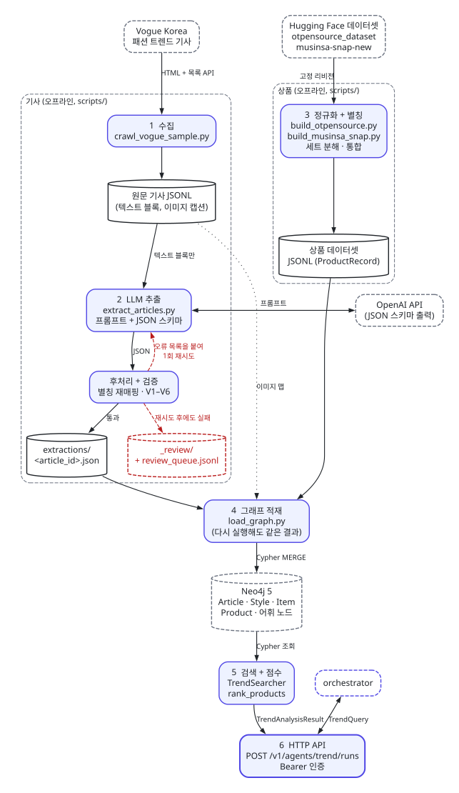

# fashion-planner-trend

패션 매거진 기사에서 트렌드와 그 트렌드를 대표하는 옷을 뽑아 지식 그래프로 만들고, "이번 시즌 이 품목에서 무엇이
유행이고 비슷한 상품은 무엇인가?"에 기사 근거와 함께 HTTP로 답하는 서비스입니다.

> 이 레포는 **fashion-planner** 5개 레포 중 하나입니다. 전체 구조와 실행 방법은 [fashion-planner-orchestrator](https://github.com/KG-RAG-02/fashion-planner-orchestrator)에서 시작하세요.

| 레포 | 역할 |
|---|---|
| [fashion-planner-orchestrator](https://github.com/KG-RAG-02/fashion-planner-orchestrator) | 기획 질의 구조화, 6단계 워크플로 실행, 웹 UI, 기획서 PNG, Docker 통합 배포 |
| **[fashion-planner-trend](https://github.com/KG-RAG-02/fashion-planner-trend)** | **Vogue Korea 기사에서 트렌드 추출, Neo4j 지식 그래프, 유사 상품 검색** |
| [fashion-planner-inventory](https://github.com/KG-RAG-02/fashion-planner-inventory) | 트렌드에 맞는 과잉재고 상품 매칭(규칙 + CLIP) |
| [fashion-planner-novelty](https://github.com/KG-RAG-02/fashion-planner-novelty) | 트렌드 기반 신상품(novelty) 기획안과 제품·착장 이미지 생성 |
| [fashion-planner-research](https://github.com/KG-RAG-02/fashion-planner-research) | 기획안의 판매·시장 조사(가격, 원단 원가, 고객 연령, 타깃) |

## 개요

1. LLM이 기사마다 **Style**(기사가 지금 유행이라고 소개한 트렌드), 그 트렌드를 대표하는 **Item**(옷), 속성을 뽑습니다.
   모든 값은 기사 원문 인용과 연결됩니다.
2. 공개 상품 데이터셋 두 개를 같은 속성 어휘로 정규화합니다.
3. 둘을 **Neo4j**에 넣습니다. 질의(시즌, 트렌드명, 카테고리, 속성)가 오면 그래프를 따라가 상품 후보를 찾고,
   설명 가능한 결정론적 점수로 순위를 매깁니다. 질의 시점에는 LLM을 부르지 않습니다.

## 아키텍처

<picture>
  <source media="(prefers-color-scheme: dark)" srcset="docs/diagrams/pipeline-dark.svg">
  
</picture>

자세한 내용은 [docs/architecture.md](docs/architecture.md), 그래프 모델은 [docs/graph-schema.md](docs/graph-schema.md)에 있습니다.

## 기능

- **근거가 붙는 결과**: 트렌드와 옷마다 기사 블록 번호와 원문 인용이 붙고, 결과의 근거 id는 다시 계산해도 같습니다.
- **검증하는 추출**: 엄격한 JSON 스키마 출력, 별칭 사전 재매핑, 인용과 원문 값이 가리킨 블록에 실제로 있는지 검사(V1~V6),
  1회 재시도, 실패 기사는 검토 대기열로, 로컬 응답 캐시.
- **설명 가능한 순위**: 일치·불일치·미확인 속성과 속성별 점수 분해를 함께 돌려줍니다.
- **이유가 있는 "없음"**: 결과가 없으면 이유(트렌드명 없음, 시즌 불일치, 시즌 미확인 등)를 `limitations`에 적습니다.
- **오프라인 stub**: 합성 그래프로 실제 데이터나 API 키 없이 요청 처리 전체를 돌려 볼 수 있습니다.

## 빠른 시작 (오프라인 stub)

Python 3.12와 Docker가 필요합니다. 실제 데이터를 받거나 LLM을 호출하지 않습니다.

```bash
git clone https://github.com/KG-RAG-02/fashion-planner-trend.git && cd fashion-planner-trend
python3.12 -m venv .venv && source .venv/bin/activate
pip install -e ".[dev]"

# 1. 비어 있는 로컬 Neo4j (비밀번호는 아무 값이나 정한다)
cp .env.example .env            # .env의 NEO4J_PASSWORD를 채운다
docker compose up -d neo4j      # `docker compose ps`가 healthy가 될 때까지 기다린다

# 2. 합성 그래프 적재 (접속값은 환경변수에서만 읽는다)
export NEO4J_URI=bolt://127.0.0.1:7687 NEO4J_USER=neo4j NEO4J_PASSWORD=<.env에 넣은 값>
python scripts/seed_fixture_graph.py          # 요약을 출력하고, status가 ok면 종료 코드 0

# 3. API를 127.0.0.1:8768에 띄우고 예시 요청을 보낸다
export FASHION_PLANNER_SERVICE_TOKEN=local-dev-token
python -m fashion_planner_trend.api.server &
curl -s -X POST http://127.0.0.1:8768/v1/agents/trend/runs \
  -H "Authorization: Bearer $FASHION_PLANNER_SERVICE_TOKEN" -H "Content-Type: application/json" \
  --data @examples/stub/trend-request.json
```

응답은 `examples/stub/trend-response-summary.json`과 같아야 합니다. 실제 출처로 그래프를 만들려면
[docs/data.md](docs/data.md)를 따르세요(라이선스 주의 사항이 있습니다).

## 설정

설정은 프로세스 환경변수, 그다음 `.env`에서 읽습니다(`.env.example` 참고, `.env`는 커밋하지 않습니다).

| 변수 | 쓰는 곳 | 뜻 |
|---|---|---|
| `NEO4J_URI`, `NEO4J_USER`, `NEO4J_PASSWORD` | API, 적재, 스크립트 | 그래프 DB. 호스팅 Neo4j의 `neo4j+s://` 주소도 됩니다 |
| `FASHION_PLANNER_SERVICE_TOKEN` | API | 서비스 공용 Bearer 토큰. 비어 있으면 `runs` 요청을 모두 거부하고, service 모드는 시작하지 않습니다 |
| `TREND_API_HOST`, `TREND_API_PORT`, `TREND_API_MODE` | API | 바인드 주소(기본 `127.0.0.1`), 포트(`8768`), `local` 또는 `service`(service는 `0.0.0.0`에만 바인드) |
| `LLM_API_KEY`, `LLM_MODEL` | 추출 | OpenAI API 키와 모델(필수, 코드에 기본 모델이 없습니다) |
| `LLM_REASONING_EFFORT`, `LLM_TIMEOUT_S`, `LLM_CACHE_DIR`, `LLM_CALL_LOG` | 추출 | 선택. [docs/extraction.md](docs/extraction.md) 참고 |
| `NEO4J_TEST_URI` | 테스트 | `-m neo4j` 테스트용 로컬 Neo4j(테스트가 그래프를 비웁니다) |
| `NEO4J_BOLT_PORT`, `NEO4J_HTTP_PORT` | `docker-compose.yml` | 기본 포트가 이미 쓰일 때 바꿀 호스트 포트 |
| `HF_HOME` | 상품 빌드 | Hugging Face 캐시 위치 |

점수 가중치는 `configs/weights.yaml`, 별칭 사전은 `configs/alias_map/`, 추출 프롬프트는 `prompts/article_extraction.md`,
LLM 모델 등록표는 `configs/llm_models.yaml`에 있습니다.

## 데이터

이 레포에는 기사 원문, 상품 레코드, 이미지, 정답 라벨이 **없습니다**. 합성 fixture만 있습니다. 출처, 라이선스 상태,
데이터를 받고 만드는 법, 재현할 수 없는 부분은 [docs/data.md](docs/data.md)에 있습니다.

## API와 계약

`GET /health`와 `POST /v1/agents/trend/runs`(봉투 `{contract_version: "trend-handoff", request_id, input: TrendQuery}`)를
제공하고 `TrendAnalysisResult`(`schema_version` `1.0.0`)를 돌려줍니다. 필드, 오류 코드, 예시는 [docs/contracts.md](docs/contracts.md)에 있습니다.

## 프로젝트 구조

```
configs/            점수 가중치, 별칭 사전, LLM 모델 등록표
docker/             API 이미지(Dockerfile)
docs/               아키텍처, 계약, 그래프 스키마, 추출, 어휘, 라벨링, 데이터 카드, 문제 해결, 설계 결정, 다이어그램
examples/stub/      합성 요청과 기대 응답
prompts/            추출 프롬프트
scripts/            수집, 추출, 상품 빌드, 그래프 적재, stub 적재, 점검, 다이어그램 렌더
src/fashion_planner_trend/
  api/              HTTP 서버
  graph/            적재, 검색, 합성 fixture
  retrieval/        가중치와 점수
  ingestion/        수집기, LLM 추출, 상품 정규화
  llm/              OpenAI 클라이언트, 캐시, 모델 등록표
  schemas/          Pydantic 모델과 표준 어휘
tests/              오프라인 단위 테스트(+ NEO4J_TEST_URI가 있을 때만 도는 Neo4j 테스트)
```

## 테스트

```bash
pip install -e ".[all,dev]"
python -m pytest -q -rs
```

모든 테스트는 오프라인으로 돕니다. 테스트 중에는 외부 네트워크 연결을 막아 두었습니다(`tests/conftest.py`).
Neo4j 테스트는 `NEO4J_TEST_URI`가 로컬의 지워도 되는 인스턴스를 가리킬 때만 돌고, 로컬 정답 라벨이 필요한 테스트는
라벨이 없으면 건너뜁니다. CI도 같은 명령을 씁니다.

## 문제 해결과 교훈

Neo4j 재시작 반복, Windows에서의 호스팅 Neo4j TLS, LLM이 만든 자리표시자 이름, 평가 누출처럼 설치 중 막히는 곳과
개발하며 배운 점은 [docs/troubleshooting.md](docs/troubleshooting.md), 설계 결정은 [docs/decisions/](docs/decisions/)에 있습니다.

## 한계

- 한국어 원천을 전제로 합니다. 어휘 값과 결과의 `limitations` 문장은 한국어입니다.
- 추출한 트렌드의 약 28%는 시즌이 없어 시즌 질의에 나오지 않습니다.
- 상품 속성이 비어 있어도 점수가 깎이지 않습니다. 결과의 `match.unknown`을 확인하세요.
- 기사 사이의 같은 트렌드를 합치지 않으므로 비슷한 트렌드가 여러 번 나올 수 있습니다.
- 원래 그래프에 쓴 상품 데이터는 사람이 검수한 것이라 이 코드로 다시 만들 수 없습니다.
- 평가셋이 작아서 프롬프트와 모델 선택은 벤치마크가 아니라 점검 수준입니다.

## 감사의 말

- 상품 데이터: Hugging Face의 [hateslopacademy/otpensource_dataset](https://huggingface.co/datasets/hateslopacademy/otpensource_dataset),
  [disl/musinsa-snap-new](https://huggingface.co/datasets/disl/musinsa-snap-new)
- 속성 어휘: K-Fashion 이미지 AI 데이터 구축 가이드라인(AI Hub)
- 기사 출처: Vogue Korea(재배포하지 않음)
- 다이어그램은 Graphviz로 그리고 글꼴은 [Pretendard](https://github.com/orioncactus/pretendard)(SIL Open Font License)를 씁니다.
  글꼴 파일과 아이콘·로고는 레포에 넣지 않았습니다.
- 코드와 문서 일부는 AI 코딩 도우미(Anthropic Claude)의 도움을 받아 작성했고, 해당 커밋에는 `Co-Authored-By`를 남겼습니다.
  만든 사람은 [AUTHORS.md](AUTHORS.md)에 있습니다.

## 고지

- 이 프로젝트는 학습·교육 목적의 비상업 프로젝트입니다. Condé Nast, Vogue Korea(두산매거진), 무신사, H&M과 관련이 없으며 이들의 승인이나 후원을 받지 않았습니다. 'Vogue'는 해당 권리자의 상표입니다.
- 이 레포에는 제3자 데이터(기사 원문, 이미지, 상품·거래 데이터)가 들어 있지 않습니다. 데이터를 직접 받아 쓰는 경우 각 출처의 이용약관을 따라야 합니다. 자세한 내용은 `docs/data.md`를 보세요.

## 라이선스

코드는 [MIT 라이선스](LICENSE)로 배포합니다. MIT 라이선스는 이 레포의 코드에만 적용되며, 외부 데이터셋과 그 파생물에는 적용되지 않습니다.
