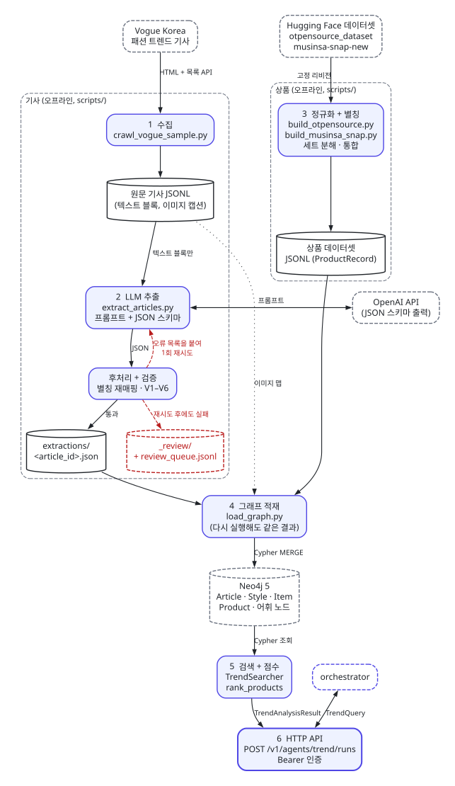
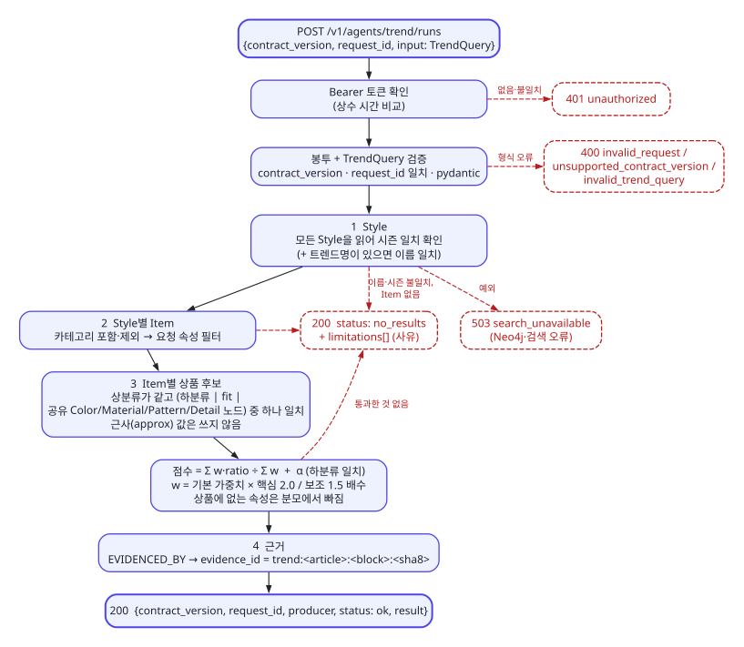

# 아키텍처

fashion-planner-trend는 패션 매거진 기사에서 **트렌드(Style) → 대표 옷(Item) → 속성**으로 이루어진 작은
지식 그래프를 만들고, 그 옷과 비슷한 상품을 연결해 구조화된 트렌드 질의에 HTTP로 답한다. Fashion Planner
오케스트레이터가 가장 먼저 부르는 서비스다.

- [전체에서의 위치](#전체에서의-위치)
- [오프라인 파이프라인](#오프라인-파이프라인)
- [요청 처리 경로](#요청-처리-경로)
- [점수 계산](#점수-계산)
- [코드 구성](#코드-구성)
- [실행과 배포](#실행과-배포)
- [설계 결정](#설계-결정)

## 전체에서의 위치

| 레포 | 역할 |
|---|---|
| fashion-planner-orchestrator | 기획 질문을 구조화하고 아래 서비스를 차례로 불러 기획안을 만든다 |
| **fashion-planner-trend** (이 레포) | 지금 유행하는 트렌드, 그 트렌드를 대표하는 옷, 비슷한 상품을 기사 근거와 함께 찾는다 |
| fashion-planner-inventory | 트렌드 결과에 맞는 재고 짝 상품과 과잉 재고 우선순위를 고른다 |
| fashion-planner-research | 기획 상품의 판매·시장 근거를 검토한다 |
| fashion-planner-novelty | 트렌드 결과와 다른 입력으로 신상품 기획안과 콘셉트 이미지를 만든다 |

오케스트레이터는 trend를 먼저 부르고, trend 결과를 **고치지 않은 채** 하류 서비스에 넘긴다.
HTTP 계약은 [contracts.md](contracts.md)에 있다.

## 오프라인 파이프라인

<picture>
  <source media="(prefers-color-scheme: dark)" srcset="diagrams/pipeline-dark.svg">
  
</picture>

그래프 위쪽은 모두 사람이 `scripts/`에서 실행하는 배치 작업이다. 요청 처리 경로는 Neo4j 말고는 LLM이나
외부 네트워크를 부르지 않는다.

1. **수집** (`scripts/crawl_vogue_sample.py`): 기사마다 메타데이터, 번호가 붙은 텍스트 블록, 이미지 캡션과
   URL을 JSON으로 저장한다. 이미지 파일은 받지 않는다.
2. **추출** (`scripts/extract_articles.py`): 텍스트 블록으로 프롬프트를 만들고 OpenAI API에 엄격한 JSON 스키마
   출력을 요청한다. 원문 표현을 별칭 사전으로 다시 매핑하고, 모든 인용과 원문 값이 가리킨 블록에 실제로
   있는지 검증한다. 실패한 기사는 오류 목록을 붙여 한 번 다시 시도하고, 그래도 실패하면 그래프 대신 검토
   폴더로 보낸다. [extraction.md](extraction.md) 참고.
3. **상품 정규화** (`scripts/build_otpensource.py`, `build_musinsa_snap.py`, `build_musinsa_dataset.py`):
   공개 상품 데이터셋 두 개를 같은 어휘로 맞춘다. LLM 없이 규칙만 쓴다(별칭 사전, 키워드 오탐 방지,
   여러 벌 세트 분해). [vocabulary.md](vocabulary.md) 참고.
4. **적재** (`scripts/load_graph.py`): 상품과 추출 결과를 Neo4j에 쓴다. 노드는 id로 MERGE하고, 상품의 관계는
   다시 만들고, 기사의 Style·Item은 한 트랜잭션에서 통째로 바꾼다. 그래서 여러 번 실행해도 같은 그래프가
   나온다. [graph-schema.md](graph-schema.md) 참고.

데이터 출처, 라이선스, 재현할 수 없는 부분은 [data.md](data.md)에 있다.

## 요청 처리 경로

<picture>
  <source media="(prefers-color-scheme: dark)" srcset="diagrams/request-flow-dark.svg">
  
</picture>

`TrendSearcher.search()`(`src/fashion_planner_trend/graph/search.py`)는 네 단계로 동작한다.

1. **Style**: 모든 Style 노드를 읽고, 요청 시즌이 `seasons`에 들어 있는 Style만 남긴다. 시즌이 없는 Style은
   보류하고 `limitations`에 알린다. 질의에 트렌드명이 있으면 공백을 지우고 소문자로 바꾼 이름이 서로 포함되는 Style만 남긴다.
   Item이 없는 Style은 그래프에는 있지만 상품 검색에서는 뺀다.
2. **Item**: 남은 Style의 Item을 요청한 상분류·하분류로 거르고, 요청 속성으로 거른다. 요청과 **명시적으로**
   다른 값을 가진 Item만 뺀다(값이 없으면 통과).
3. **상품**: Item과 상분류가 같고, 하분류·fit·Color/Material/Pattern/Detail 노드 중 하나 이상을 공유하는 상품이
   후보다. 근사(`approx`) 값으로는 후보를 만들지 않는다. 후보를 요청 속성으로 거르고 점수를 매겨 상위
   *k*개(기본 5)를 남긴다.
4. **근거**: Style과 Item은 `EVIDENCED_BY` 관계로 기사와 이어지고, 관계에 블록 번호와 원문 인용이 있다.
   각각 안정된 id를 가진 근거 레코드가 된다.

중간에 끝나는 경우는 오류가 아니라 `status: "no_results"`와 `limitations`의 사유로 답한다.

## 점수 계산

`src/fashion_planner_trend/retrieval/scoring.py`의 `score_product()`는 순수 함수라서 Neo4j 없이도 같은 점수를
낸다.

```
점수    = Σ_a w_a · ratio_a / Σ_a w_a  +  α · m_category · [하분류 일치]
w_a     = 기본 가중치_a × m_a
m_x     = 트렌드 배수 (핵심 2.0, 보조 1.5, 그 밖 1.0)
ratio_a = |Item 값 ∩ 상품 값| / |Item 값|
```

- 속성 `a`는 color, detail, pattern, material, fit이다. 기본 가중치(color·detail 3, 나머지 2)와 α(0.1)는
  `configs/weights.yaml`에 있다. 작은 평가셋에서 균등 가중치와 순위 품질이 같게 나왔으므로, 기본값은 조정이
  끝난 최적값이 아니라 출발점으로 본다.
- Item에 값이 있는 속성만 비교한다. 상품에 그 속성 값이 없으면 `unknown`으로 표시하고 **분모에서 뺀다.**
  그래서 소재를 모르는 상품이 소재가 맞는 상품과 같은 점수를 받을 수 있다. 알려진 한계다
  ([troubleshooting.md](troubleshooting.md) 참고).
- 트렌드 배수는 Style의 `focus_core`·`focus_supporting`에서 온다. 기사가 트렌드의 핵심이라고 한 속성이 더
  크게 반영된다. 하분류 보너스의 배수 `m_category`는 focus에 `category`가 있을 때만 1보다 크다(최대 0.2).
- 점수가 같으면 비교한 속성 수, 일치한 값 수, 상품 id 순으로 정한다. 같은 입력은 항상 같은 순위가 된다.

## 코드 구성

| 경로 (`src/fashion_planner_trend/`) | 역할 |
|---|---|
| `api/server.py` | 표준 라이브러리 HTTP 서버: 상태 확인, 인증이 필요한 `runs` 경로, 봉투 검증 |
| `config.py` | `.env`·환경변수 읽기, API 바인드 규칙, 호스팅 Neo4j용 TLS 설정을 갖춘 드라이버 |
| `schemas/` | Pydantic 모델: `TrendQuery`, `TrendAnalysisResult`, `ArticleExtraction`, 그래프 레코드, 어휘 열거형 |
| `graph/loader.py` | 제약·인덱스, 어휘 노드 생성, 상품·기사 적재 |
| `graph/search.py` | `TrendSearcher`: 위의 네 단계 |
| `graph/fixture.py` | 테스트와 오프라인 stub용 합성 그래프 |
| `retrieval/` | 가중치 설정과 점수 함수 |
| `ingestion/crawler/` | 기사 수집기 |
| `ingestion/extraction/` | 프롬프트 렌더링, LLM 호출, 후처리, 검증, 일괄 실행 |
| `ingestion/normalization/` | 별칭 사전, 상품 정규화, 세트 분해, 데이터셋 통합, 안전한 파일 쓰기 |
| `llm/` | 엄격한 스키마 변환을 하는 OpenAI 클라이언트, 응답 캐시와 호출 기록, 모델 등록표 |
| `images.py` | 상품 이미지 참조(카탈로그 URL 또는 데이터셋 행)를 푼다 |
| `filelock.py` | LLM 캐시가 쓰는 OS 공통 파일 잠금 |

## 실행과 배포

- **Python 3.12**, 표준 라이브러리 HTTP 서버(`ThreadingHTTPServer`), 공식 드라이버로 Neo4j 5에 접속한다.
- **local 모드**는 루프백에만 바인드한다. **service 모드**는 `0.0.0.0`에 바인드하고, Bearer 토큰이 없으면
  시작하지 않는다. [contracts.md § HTTP API](contracts.md#http-api) 참고.
- **컨테이너**: API 이미지는 uid/gid 10001로 실행되고 `/app` 아래에 아무것도 쓰지 않는다. 읽기 전용 루트
  파일시스템과 `/tmp` tmpfs만으로 동작한다.
- **오프라인 stub**: `scripts/seed_fixture_graph.py`가 합성 그래프를 비어 있는 로컬 Neo4j에 적재한다.
  호스팅 주소(`*.neo4j.io`)와 비어 있지 않은 그래프는 `--allow-wipe` 없이는 거부한다. 실제 데이터나 API 키
  없이 요청 경로 전체를 돌려 볼 수 있다. README의 빠른 시작 참고.

## 설계 결정

[decisions/](decisions/)에 기록했다.

- Neo4j 속성 그래프 + Cypher 후보 검색 + 결정론적 점수
- 추출 모델과 프롬프트 기준선
- 기사마다 Style을 따로 둔다(기사 간 자동 병합 없음)
- 근사 값은 저장하되 점수에 쓰지 않는다
- 표준 어휘는 K-Fashion 속성 목록
- 정답 라벨은 그래프에 올리지 않는다
- 시즌 질의는 기사에 적힌 시즌만 맞춘다
