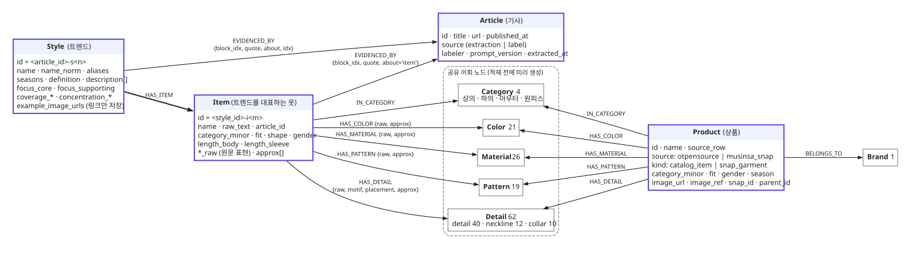

# 그래프 스키마

서비스가 검색하는 데이터는 모두 Neo4j 그래프 하나에 있다.

- **Article**·**Style**·**Item** 노드는 패션 매거진 기사를 LLM으로 추출한 결과에서 온다([extraction.md](extraction.md)).
- **Product** 노드는 Hugging Face 공개 데이터셋 두 개에서 온다. `hateslopacademy/otpensource_dataset`은 상품 카탈로그이고 `disl/musinsa-snap-new`는 스냅 사진 속 의류다.
- **어휘 노드**(Category·Color·Material·Pattern·Detail·Brand)는 Item과 Product가 함께 쓴다. 비슷한 상품은 이 공유 노드를 거쳐 찾는다.

무엇을 쓰는지는 적재기 `src/fashion_planner_trend/graph/loader.py`가 정하고, 이 문서의 기준도 그 파일이다. 노드 모델은 `src/fashion_planner_trend/schemas/graph_schema.py`에, 표준 값은 `src/fashion_planner_trend/schemas/vocabulary.py`에 있다.

<picture>
  <source media="(prefers-color-scheme: dark)" srcset="diagrams/graph-schema-dark.svg">
  
</picture>

## 한눈에 보기

| 라벨 | 의미 | `id` 형식 | 만드는 단계 |
|---|---|---|---|
| `Article` | 크롤링한 기사 1건 | 크롤러의 `article_id` | 기사 적재 |
| `Style` | 기사에서 추출한 트렌드 | `<article_id>-s<n>` | 기사 적재 |
| `Item` | 기사가 그 트렌드의 예로 든 옷 한 벌 | `<style_id>-i<m>` | 기사 적재 |
| `Product` | 두 데이터셋에서 온 의류 | `otpensource:…` 또는 `musinsa_snap:…`([Product](#product) 참고) | 상품 적재 |
| `Category`, `Color`, `Material`, `Pattern`, `Detail`, `Brand` | 표준 어휘 값 | 표준 값 그대로(Detail은 `<type>:<name>`) | 적재할 때마다 미리 만든다 |

## 평탄화 규칙

Neo4j 속성에는 원시 값과 그 배열만 넣을 수 있다. 추출 결과(`ArticleExtraction`)와 상품 레코드는 중첩 JSON이므로 적재기가 다음 규칙으로 평탄화한다.

| 규칙 | 의미 | 예 |
|---|---|---|
| 접미사 `_raw` | 원문 표현을 그대로 둔다 | `fit_raw` = `"와이드"` |
| 접미사 없음 | 표준 어휘 값 | `fit` = `"와이드"` |
| 합성 이름 | `_`로 잇는다 | 기장 → `length_body_raw`·`length_body`, 함께 쓴 액세서리 → `styling_accessory` |
| 값이 여러 개이고 탐색 경로로 쓰는 것 | 공유 어휘 노드로 가는 **관계**로 만든다. 원문은 관계 속성에 둔다 | `colors[]` → `HAS_COLOR {raw}` |
| 값이 여러 개이고 탐색 경로가 아닌 것 | 문자열 배열 속성 | `seasons`, `sub_colors`, `image_urls` |
| `category_major` | 속성이 아니라 `IN_CATEGORY` 관계 | `(Item)-[:IN_CATEGORY]->(:Category {id: "아우터"})` |
| `null` | 속성을 **만들지 않는다**. 없는 속성을 읽으면 `null`이다 | |
| Enum | 문자열 값으로 저장한다 | `Fit.WIDE` → `"와이드"` |
| 빈 목록 | 빈 배열로 저장한다 | `aliases: []`, `approx: []` |

`ArticleExtraction`의 중첩 경로는 그래프에서 다음 위치로 간다.

| 추출 경로 | 그래프 위치 |
|---|---|
| `styles[]` | `Style` 노드 |
| `styles[].seasons[]` (`{year, season}`) | `Style.seasons`. `"2030SS"` 같은 키로 합친다 |
| `styles[].description[].text` | `Style.description`(문자열 배열). 근거 → `EVIDENCED_BY {about: "description", idx}` |
| `styles[].focus_attributes[]` | `Style.focus_core`·`Style.focus_supporting`(등급별 속성 이름). 근거 → `EVIDENCED_BY {about: "focus"}` |
| `styles[].evidence[]` | `(Style)-[:EVIDENCED_BY {about: "style"}]->(Article)` |
| `styles[].items[]` | `Item` 노드와 `(Style)-[:HAS_ITEM]->(Item)` |
| `items[].colors[]`, `materials[]`, `patterns[]` | `HAS_COLOR`·`HAS_MATERIAL`·`HAS_PATTERN {raw, approx}`. `value`가 `null`이면 관계를 만들지 않는다 |
| `items[].details[]` | `Detail {id: "<type>:<value>"}`로 가는 `HAS_DETAIL {raw, motif, placement, approx}`. `value`가 `null`이면 관계를 만들지 않는다 |
| `items[].evidence[]` | `(Item)-[:EVIDENCED_BY {about: "item"}]->(Article)` |
| `items[].image_links[]` | `Item.image_urls`·`Item.image_basis`. URL은 크롤 파일에서 찾는다 |
| `category_major = null`인 Item | **적재하지 않는다.** 추출 JSON에는 남는다 |
| `items[].review_flags`, `items[].size` | 적재하지 않는다 |

## 이름 정규화

`src/fashion_planner_trend/schemas/graph_schema.py`의 `normalize_term()`이 Style 이름·별칭의 비교 키를 만든다. 이 키는 `Style.name_norm`과 `Style.aliases_norm`에 저장된다. 함수를 바꾸면 저장된 키가 모두 바뀌므로 스키마의 일부로 다룬다.

1. 유니코드 NFKC로 정규화한 뒤 소문자로 바꾼다.
2. 공백과 다음 문자를 지운다: ``- _ · • ' " ‘ ’ “ ” ` . , ( ) [ ] { } : ; / ! ?``
3. 나머지는 그대로 둔다. 끝에 붙은 일반어(`룩`, `스타일` 등)도 지우지 않는다.

| 입력 | `normalize_term` |
|---|---|
| `피스타치오 테일러링` | `피스타치오테일러링` |
| `‘피스타치오 테일러링’(Pistachio Tailoring)` | `피스타치오테일러링pistachiotailoring` |
| `PISTACHIO  tailoring!` | `pistachiotailoring` |
| `피스타치오 테일러링 룩` | `피스타치오테일러링룩` (`피스타치오테일러링`과 다르다) |

정규화는 표기 차이만 없앤다. 서로 다른 말을 같은 이름으로 만들지는 않는다.

## 노드

타입 뒤의 `?`는 속성이 없을 수 있다는 뜻이다.

### Article

| 속성 | 타입 | 의미 |
|---|---|---|
| `id` | string | 크롤러의 `article_id` |
| `title`, `url` | string? | 추출 파일의 `label_meta`에서 가져온다. 거기에 값이 없으면 크롤 파일에서 가져온다 |
| `published_at` | string? | `YYYY-MM-DD` |
| `label_status` | string? | `label_meta.status`. LLM 추출이면 `auto`, 사람이 검수한 라벨 파일이면 `silver` 또는 `gold`다 |
| `source` | `extraction` \| `label` | `label_status`가 `auto`이면 `extraction`이다 |
| `labeler`, `prompt_version`, `extracted_at` | string? | LLM 추출일 때만 있다. 각각 `llm:<backend>/<model>`, 프롬프트 id(`article-extraction`), 추출 시각이다 |

### Style

| 속성 | 타입 | 의미 |
|---|---|---|
| `id` | string | `<article_id>-s<n>`. `n`은 `styles[]` 안의 위치(0부터)다 |
| `article_id` | string | 출처 기사 |
| `name` | string | 기사에 나온 트렌드명 그대로 |
| `name_origin` | `article` \| `analyst` | LLM 추출은 항상 `article`이다(검증 코드 `V1`). `analyst`는 사람이 쓴 라벨 파일에만 나온다 |
| `name_norm` | string | `normalize_term(name)` |
| `aliases` | string[] | 같은 기사에 나온 다른 이름(영문 병기·번역·약칭). 원문 그대로이고 중복은 지운다 |
| `aliases_norm` | string[] | 정규화한 별칭. 중복, 빈 값, `name_norm`과 같은 값은 지운다 |
| `seasons` | string[] | 그 트렌드가 유행한다고 기사가 말한 시즌. 예: `["2030SS"]`. 비어 있으면 시즌을 모른다는 뜻이다 |
| `definition` | string | 한 문장 정의 |
| `description` | string[] | 상품 기획에 참고할 사실. 항목 하나에 사실 하나다 |
| `focus_core`, `focus_supporting` | string[] | 기사가 이 트렌드에서 강조한 속성: `category`, `color`, `material`, `pattern`, `detail`, `fit` |
| `item_count` | int | 적재된 Item 수. 상분류가 있는 Item만 센다 |
| `coverage_<attr>` | float? | `color`·`material`·`pattern`·`detail`·`fit`별로 표준 값이 하나 이상 있는 Item의 비율이다. `item_count = 0`이면 없다 |
| `concentration_<attr>` | float? | 값이 있는 Item 가운데 가장 많이 나온 값을 가진 Item의 비율이다. 값이 있는 Item이 없으면 없다 |
| `example_image_urls` | string[] | 크롤 파일에서 고른 예시 사진 URL. 최대 5장이다 |
| `example_image_basis` | string[] | `example_image_urls`와 길이가 같다. 각 사진을 고른 근거로 `item_link`, `section`, `article` 중 하나다 |

- `item_count`·`coverage_*`·`concentration_*`는 기사를 적재할 때마다 다시 계산한다. 소수 넷째 자리로 반올림하고 근사 값도 센다. 이 값은 **확인용으로만** 저장하며 검색·점수 계산에서는 읽지 않는다.
- Item이 모두 지원 범위 밖인 Style도 노드로 적재한다. 이때는 `HAS_ITEM` 관계만 없다. 검색은 `HAS_ITEM` 관계가 있는지를 보고 이런 Style을 결과에서 빼며, 뺐다는 사실을 `limitations`에 적는다.
- **예시 사진은 링크로만 저장한다.** 적재기는 이미지 파일을 내려받거나 저장하지 않고, API 응답도 URL을 링크로만 돌려준다. Style마다 아래 순서로 사진을 고른다. 중복은 건너뛰고 5장이 되면 멈춘다.
  1. `item_link`: 그 Style의 Item이 연결한 사진(`image_links`). 지원 범위 밖 Item의 사진도 포함한다.
  2. `section`: 그 Style의 근거 블록이 있는 크롤 섹션 가운데 같은 기사의 다른 Style이 쓰지 않는 섹션의 사진.
  3. `article`: 기사에 Style이 하나뿐이면 기사의 사진 전체.

  이 선택은 휴리스틱이며 정확도를 검수하지 않았다. 크롤 파일이 없으면 두 목록 모두 비어 있다.

### Item

| 속성 | 타입 | 의미 |
|---|---|---|
| `id` | string | `<style_id>-i<m>`. `m`은 `items[]` 안의 위치(0부터)다. 지원 범위 밖 Item도 자리를 차지하므로 번호가 건너뛸 수 있다 |
| `article_id` | string | 출처 기사(인덱스 있음) |
| `name`, `raw_text` | string | 짧은 아이템 이름과 그 옷을 서술한 원문 구절 |
| `gender` | string? | `남`, `여`, `공용`. 기사가 밝힌 경우에만 있다 |
| `category_raw`, `category_minor` | string? | 카테고리 원문과 표준 하분류 21개 중 하나(예: `재킷`) |
| `fit_raw`, `fit` | string? | 핏 원문과 표준 핏 7개 중 하나 |
| `shape_raw`, `shape` | string? | 실루엣(세이프) 원문과 표준 값. 표시용으로만 저장하고 점수에는 쓰지 않는다 |
| `length_body_raw`, `length_body`, `length_sleeve_raw`, `length_sleeve` | string? | 기장과 소매 길이. 점수에 쓰지 않는다 |
| `styling_raw`, `styling_accessory` | string? | 착용 방식과 함께 쓴 액세서리 |
| `image_urls`, `image_basis` | string[] | 연결된 사진 URL과 각 사진의 연결 근거(`caption_brand`, `adjacent`, `order`) |
| `approx` | string[] | 근사 매핑으로 채운 스칼라 필드 이름. Item에서는 `fit`뿐이다 |

### Product

| 속성 | 타입 | 의미 |
|---|---|---|
| `id` | string | 아래 참고 |
| `source` | `otpensource` \| `musinsa_snap` | 출처 데이터셋 |
| `kind` | `catalog_item` \| `snap_garment` | 판매 상품, 또는 스냅 사진 속 의류(구매할 수 있는 상품이 아니다) |
| `name` | string? | 상품명. 카탈로그 상품에만 있다 |
| `gender`, `season` | string? | `남`·`여`·`공용`, 그리고 `SS`·`FW`. 카탈로그 상품에만 있다 |
| `category_raw`, `category_minor`, `fit_raw`, `fit`, `shape_raw`, `shape`, `length_body_raw`, `length_body`, `length_sleeve_raw`, `length_sleeve` | string? | Item과 같은 뜻 |
| `sub_colors` | string[] | 서브컬러. 필터·점수에 쓰지 않는다 |
| `source_row` | string | 원본 데이터셋에서의 위치(추적용) |
| `approx` | string[] | 근사 매핑으로 채운 스칼라 필드 이름. 예: `["length_body"]` |
| `image_url` | string? | 카탈로그 이미지 URL |
| `image_ref` | string? | 이미지 참조를 하나로 통일한 필드다. 카탈로그 상품은 이미지 URL, 스냅 의류는 `hf://datasets/disl/musinsa-snap-new@<revision>#row=<row>`다 |
| `image_scope` | `catalog` \| `full_snap` \| `full_set`? | 상품 컷 / 스냅 원본 사진 한 장(같은 사진의 의류가 함께 쓴다) / 부모 이미지를 함께 쓰는 세트 구성품 |
| `image_status` | `ok` \| `broken` \| `unchecked`? | 마지막 점검 때 이미지를 받거나 디코드할 수 있었는지. `ok`라도 그 이미지가 이 옷을 보여 준다는 뜻은 아니다 |
| `snap_id` | int? | 스냅 사진의 parquet 행 번호(0부터). 한 사진의 의류는 같은 값을 갖는다 |
| `multi_wearer_suspected` | bool? | 사진에 여러 명이 찍혔을 수 있을 때만 `true`로 둔다 |
| `parent_id`, `split_from` | string? | 세트를 나눈 구성품일 때: 원래 상품 id와 분해 근거(`name_rule` 또는 `review`) |
| `dup_of` | string? | 내용이 같은 앞선 상품 id. 표시만 하고 병합하거나 지우지 않는다 |
| `multipack`, `split_candidate` | bool? | 해당할 때만 `true`. 같은 상품 N개 묶음 / 세트 표지는 있으나 근거가 부족해 나누지 않은 행 |

Product `id` 형식은 다음과 같다.

- `otpensource:<file>:<row>`. 세트를 나눈 구성품은 뒤에 `#<k>`(1부터)가 붙어 `otpensource:<file>:<row>#<k>`가 된다.
- `musinsa_snap:<row>:<slot>`. 한 슬롯에 라벨이 여럿이면 `musinsa_snap:<row>:<slot>:<k>`다. `<row>`는 `snap_id`와 같은 parquet 행 번호(0부터)다.

"이미지가 있다"는 판정은 저장하지 않고 검색할 때 계산한다. `image_status`가 있으면 그 값이 `ok`일 때만 이미지가 있다고 본다. 없으면 `image_url`이나 `image_ref`가 있을 때 이미지가 있다고 본다.

### 어휘 노드

| 라벨 | 개수 | `id` | 다른 속성 |
|---|---|---|---|
| `Category` | 4 | `상의`, `하의`, `아우터`, `원피스`(드레스·점프수트) | `name` |
| `Color` | 21 | 예: `블랙`, `그린` | `name` |
| `Material` | 26 | 예: `린넨` | `name` |
| `Pattern` | 19 | `무지` 포함 | `name` |
| `Detail` | 62 | `<type>:<name>`. `type`은 `detail`(40), `neckline`(12), `collar`(10) 중 하나다. `detail:후드`와 `neckline:후드`는 서로 다른 노드다 | `name`, `type` |
| `Brand` | 1 | `Musinsa` | `name` |

어휘 노드의 `id`는 언제나 표준 값이고 별칭으로 만들지 않는다. 원문 표현을 표준 값으로 옮기는 일은 `configs/alias_map/`의 별칭 사전이 맡는다.

## 관계

| 타입 | 시작 → 끝 | 속성 | 비고 |
|---|---|---|---|
| `HAS_ITEM` | Style → Item | 없음 | |
| `EVIDENCED_BY` | Style → Article | `block_idx`, `quote`, `about`, `idx` | `about`은 `style`(이름·정의·시즌), `description`, `focus` 중 하나다. `idx`는 `description` 안의 위치이고 다른 경우에는 없다 |
| `EVIDENCED_BY` | Item → Article | `block_idx`, `quote`, `about` = `item` | |
| `IN_CATEGORY` | Item, Product → Category | 없음 | 노드마다 정확히 하나 |
| `HAS_COLOR` | Item, Product → Color | `raw`, `approx` | 주색만 잇는다. 상품의 서브컬러는 `sub_colors` 속성에 있다 |
| `HAS_MATERIAL` | Item, Product → Material | `raw`, `approx` | |
| `HAS_PATTERN` | Item, Product → Pattern | `raw`, `approx` | |
| `HAS_DETAIL` | Item, Product → Detail | `raw`, `motif`, `placement`, `approx` | 장식·구조, 넥라인, 칼라 |
| `BELONGS_TO` | Product → Brand | 없음 | 모든 상품이 `Musinsa`에 속한다 |

- `block_idx`는 기사 블록 번호(크롤 파일의 `blocks[].idx`)이고, `quote`는 그 블록에서 글자 그대로 복사한 인용이다. 결과 파일을 쓰기 전에 추출 단계가 모든 인용을 검사한다([extraction.md](extraction.md#검증)). 적재기는 다시 검사하지 않는다.
- `raw`·`motif`·`placement`는 값이 없으면 만들지 않는다. `approx`는 적재기가 항상 불리언으로 쓴다.
- **Item과 Product를 직접 잇는 관계는 없다.** 비슷한 상품은 `(Item)-[:HAS_COLOR]->(:Color)<-[:HAS_COLOR]-(Product)`처럼 공유 어휘 노드를 거쳐 찾는다.

## 근사 매핑(`approx`)

별칭 사전의 일부 항목은 근사 매핑으로 표시되어 있다. 같은 뜻이 아니라 가장 가까운 표준 값으로 옮겼다는 뜻이다. 예를 들어 `슬림`은 `타이트`로 근사한다. 근사 값은 **저장은 하지만 후보 탐색과 점수 계산에는 쓰지 않는다.**

- **저장 위치.** `HAS_COLOR`·`HAS_MATERIAL`·`HAS_PATTERN`·`HAS_DETAIL`의 불리언 `approx`, 그리고 Item·Product 노드의 필드 이름 목록 `approx`에 저장한다.
- **Product.** 상품 데이터셋을 만들 때 정규화 코드가 표시한다.
- **LLM 추출 Item.** 적재기가 색·소재·패턴·디테일의 `raw`를 별칭 사전으로 다시 판정한다. 저장된 값을 내는 사전 결과가 모두 근사이면 `approx = true`로 둔다.
- **라벨 파일 Item.** 관계의 `approx`는 `false`로 남는다. 라벨러가 정한 값을 그대로 쓴다.
- **Item의 핏(모든 Item).** `fit_raw`가 저장된 `fit`으로 근사로만 옮겨지면 `Item.approx`에 `"fit"`을 넣는다.
- **쓰임.** 후보 쿼리는 근사 관계(`WHERE NOT coalesce(r.approx, false)`)와 `'fit' IN p.approx`인 상품의 핏을 건너뛴다. 점수 계산은 근사 값을 불일치가 아니라 미확인으로 다룬다. API 결과에는 근사라고 표시해서 그대로 보여 준다.

## 제약과 인덱스

`ensure_schema()`가 적재할 때마다 아래 항목을 `IF NOT EXISTS`로 만든다.

| 이름 | 종류 | 대상 |
|---|---|---|
| `style_id`, `item_id`, `product_id`, `article_id`, `brand_id`, `category_id`, `color_id`, `material_id`, `pattern_id`, `detail_id` | 유일성 제약 | 각 라벨의 `id` |
| `product_minor`, `product_fit`, `product_source` | 범위 인덱스 | `Product.category_minor`·`.fit`·`.source` |
| `item_article` | 범위 인덱스 | `Item.article_id`(기사의 Item을 지울 때 쓴다) |
| `style_name_norm` | 범위 인덱스 | `Style.name_norm`(이름 정확 일치 조회) |
| `style_names` | 전문(full-text) 인덱스 | `Style.name`, `Style.aliases` |
| `product_names` | 전문 인덱스 | `Product.name` |

**전문 인덱스 분석기.** 적재기는 `db.index.fulltext.listAvailableAnalyzers()`를 호출해 서버에 `cjk`가 있으면 그것을 쓰고, 없으면 `standard-no-stop-words`를 쓴다. 쓴 분석기는 적재 보고의 `fulltext_analyzer`에 기록한다. `IF NOT EXISTS` 때문에 이미 있는 전문 인덱스는 처음 분석기를 유지한다. 분석기를 바꾸려면 인덱스를 지우고 다시 적재해야 한다.

전문 인덱스는 후보 제안과 직접 조회용이다. 이름이 정확히 같은지는 `name_norm`이 같은지로 판정한다. 지금의 HTTP 검색은 두 인덱스를 모두 쓰지 않는다. 요청한 트렌드명과 `Style.name`에서 공백을 지우고 소문자로 바꾼 뒤, 한쪽이 다른 쪽을 포함하면 일치로 본다. `aliases`는 보지 않는다.

## 적재

`scripts/load_graph.py`는 환경변수나 `.env`에서 Neo4j 접속값(`NEO4J_URI`, `NEO4J_USER`, `NEO4J_PASSWORD`)을 읽고 다음 순서로 실행한다.

1. `--reset`일 때만 `MATCH (n) DETACH DELETE n`을 실행한다. **묻지 않고 그래프 전체를 지운다.**
2. 제약과 인덱스를 만든다.
3. 어휘 노드를 만든다(`MERGE` + `SET`).
4. 상품을 적재한다. 입력은 `--products`(`scripts/build_musinsa_dataset.py`가 만든 통합 JSONL)이고, `--products-dir`를 주면 그 폴더의 `otpensource_all.jsonl`과 `musinsa_snap_all.jsonl`을 읽는다. `--articles-only`이면 이 단계를 건너뛴다. 상분류가 없는 상품은 건너뛰고, 500행씩 나눠 쓴다.
5. `--prune-products`일 때만 이번 입력에 없던 Product를 지운다(한 번에 최대 100,000개). 같은 실행에서 상품을 적재했을 때만 동작한다.
6. 기사를 적재한다. 입력은 `--extractions-dir`(기본 `data/processed/extractions/article-extraction/`)이다. 맨 위의 `*.json`만 읽으므로 `_review/`는 들어가지 않는다. `--crawl`은 이미지 URL과 빠진 기사 메타를 채우는 크롤 JSONL이다. 이 파일이 없으면 Item에 이미지 URL이 없고 Style에 예시 사진이 없다.
7. JSON 보고를 출력한다. `fulltext_analyzer`, 출처별 기사 수, `image_links_unmapped`, 노드·관계 수, 걸린 시간(초)이 들어 있다.

### 병합하는 것과 다시 쓰는 것

같은 입력으로 다시 실행하면 같은 그래프가 나온다.

| 대상 | 동작 |
|---|---|
| 어휘 노드 | `id`로 `MERGE`한다. 지우지 않는다 |
| Product | `id`로 `MERGE`한 뒤 `SET n = props`로 속성을 통째로 바꾼다. 기존 `IN_CATEGORY`·`HAS_*`·`BELONGS_TO` 관계는 지우고 다시 만든다 |
| 기사(기사마다 **쓰기 트랜잭션 하나**) | 이 `article_id`의 Item과 id가 `<article_id>-s`로 시작하는 Style을 모두 `DETACH DELETE`한다. 이어서 Article을 `MERGE`하고(`SET +=`이므로 속성은 더하거나 바꿀 뿐 지우지 않는다), Style을 만들고, Item과 그 관계를 쓰고, `HAS_ITEM`과 `EVIDENCED_BY`를 만든다 |
| 크롤 파일에 없는 번호를 가리키는 `image_links` | 버리고 `image_links_unmapped`로 센다 |

적재기는 주어진 입력만 건드린다. 입력에서 빠진 상품은 `--prune-products`를 실행할 때까지 남는다. 추출 파일을 지운 기사는 `--reset`을 실행할 때까지 남는다.

### 정답 라벨

사람이 검수한 라벨 파일은 같은 `{"label_meta", "extraction"}` 형식이고 `status`가 `silver` 또는 `gold`다. 라벨은 평가용 데이터이며 검색 대상 그래프의 일부가 아니므로 **기본으로 적재하지 않는다.** `--include-labels`를 주면 `--labels-dir`의 라벨도 적재한다. 한 기사에 라벨과 추출 결과가 모두 있으면 `--prefer`(기본 `extractions`)가 어느 쪽을 쓸지 정한다. 라벨 파일은 이 저장소에 들어 있지 않다.

### 오프라인 stub 그래프

`scripts/seed_fixture_graph.py`는 작은 합성 그래프(`src/fashion_planner_trend/graph/fixture.py`)를 `NEO4J_URI`가 가리키는 Neo4j에 적재한다. 기사 원문이나 상품 데이터는 들어 있지 않다. 관리형 클라우드 주소(`*.neo4j.io`)에는 적재하지 않고, 비어 있지 않은 그래프는 `--allow-wipe` 없이 거부한다. 적재에는 `load_graph.py`와 같은 적재 함수를 쓴다.

## 예시

[extraction.md](extraction.md#예시)의 합성 추출 결과(기사 `demo-0001`, "피스타치오 테일러링", 2030 S/S)는 다음과 같이 적재된다.

```text
(:Article {id: "demo-0001", source: "extraction", label_status: "auto", published_at: "2029-10-02", ...})

(:Style {id: "demo-0001-s0", name: "피스타치오 테일러링", name_norm: "피스타치오테일러링",
         aliases: ["Pistachio Tailoring"], aliases_norm: ["pistachiotailoring"],
         seasons: ["2030SS"], focus_core: ["color"], focus_supporting: [], item_count: 2,
         coverage_color: 1.0, coverage_material: 0.5, coverage_pattern: 0.0, coverage_detail: 0.5,
         coverage_fit: 0.5, concentration_color: 1.0, ...,
         example_image_urls: ["https://img.example.invalid/0.jpg"], example_image_basis: ["item_link"]})

(:Item {id: "demo-0001-s0-i0", name: "피스타치오 린넨 재킷", category_raw: "재킷",
        category_minor: "재킷", image_urls: ["https://img.example.invalid/0.jpg"], approx: []})
  -[:IN_CATEGORY]->(:Category {id: "아우터"})
  -[:HAS_COLOR {raw: "피스타치오색", approx: false}]->(:Color {id: "그린"})
  -[:HAS_MATERIAL {raw: "린넨", approx: false}]->(:Material {id: "린넨"})
  -[:HAS_DETAIL {raw: "더블브레스티드", approx: false}]->(:Detail {id: "detail:더블브레스티드"})

(:Item {id: "demo-0001-s0-i1", name: "피스타치오 와이드 팬츠", fit_raw: "와이드", fit: "와이드", ...})
  -[:IN_CATEGORY]->(:Category {id: "하의"})
```

패턴이 있는 Item이 없으므로 `concentration_pattern`은 없다.

## 예시 쿼리

세 쿼리 모두 읽기 전용이다. 오프라인 stub 그래프에서 시험하려면 `season = '2027SS'`, `term = '발레코어'`(stub의 트렌드명), `item_id = '900003-s0-i0'`을 쓴다.

**시즌의 트렌드와 Item:**

```cypher
MATCH (s:Style)
WHERE $season IN s.seasons
OPTIONAL MATCH (s)-[:HAS_ITEM]->(i:Item)-[:IN_CATEGORY]->(c:Category)
WITH s, i, c ORDER BY i.id
RETURN s.id AS style, s.name AS name, s.focus_core AS core,
       collect(i.name + ' (' + c.id + coalesce(' / ' + i.category_minor, '') + ')') AS items
ORDER BY style;
```

**이름으로 트렌드를 찾고 근거 보기:**

```cypher
CALL db.index.fulltext.queryNodes('style_names', $term) YIELD node AS s, score
MATCH (s)-[e:EVIDENCED_BY]->(a:Article)
RETURN s.id AS style, s.name AS name, score, e.about AS about, e.idx AS idx,
       e.block_idx AS block, e.quote AS quote, a.url AS article
ORDER BY score DESC, style, about, idx, block
LIMIT 25;
```

정확히 일치하는 이름만 찾으려면 `normalize_term()`으로 만든 키로 `MATCH (s:Style {name_norm: $key})`를 쓴다.

**같은 상분류에서 Item과 근사가 아닌 속성 노드를 공유하는 상품:**

```cypher
MATCH (i:Item {id: $item_id})-[:IN_CATEGORY]->(c:Category)
MATCH (i)-[ri:HAS_COLOR|HAS_MATERIAL|HAS_PATTERN|HAS_DETAIL]->(v)
      <-[rp:HAS_COLOR|HAS_MATERIAL|HAS_PATTERN|HAS_DETAIL]-(p:Product)-[:IN_CATEGORY]->(c)
WHERE type(ri) = type(rp)
  AND NOT coalesce(ri.approx, false) AND NOT coalesce(rp.approx, false)
RETURN p.id AS product, p.name AS name, p.source AS source,
       collect(DISTINCT labels(v)[0] + ':' + v.id) AS shared
ORDER BY size(shared) DESC, product
LIMIT 10;
```

서비스의 후보 집합은 이 쿼리보다 넓다. 하분류(`category_minor`)가 같거나, 근사가 아닌 `fit`이 같은 상품도 후보에 넣는다(`src/fashion_planner_trend/graph/search.py`의 `candidate_ids()`). 순위는 `src/fashion_planner_trend/retrieval/scoring.py`가 계산한다. `블랙`이나 `무지`처럼 흔한 값에서 출발하면 많은 상품을 훑게 되므로, 직접 탐색할 때는 `LIMIT`을 건다.
